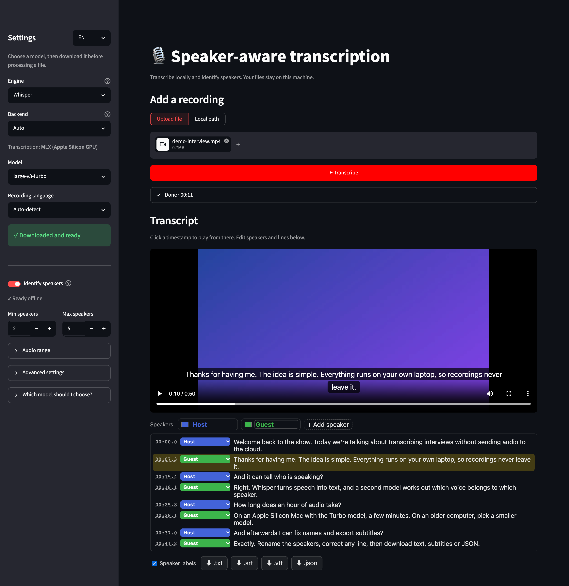
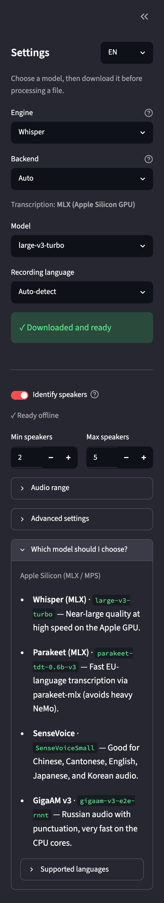

# 🎙️ Speaker Transcribe

**English** · [Русский](README.ru.md)

[](LICENSE)   

Turn interviews, meetings and podcasts into text that says **who said what**, on your
own computer. Recordings never leave your machine: no cloud API, no account.

Whisper (or another local speech-recognition engine) writes the text, and
[pyannote](https://github.com/pyannote/pyannote-audio) figures out the speakers. You
check the result next to the video, fix names or lines, and download TXT, SRT, VTT or
JSON.



## Features

- **Runs locally.** Audio and video stay on your machine; telemetry is off.
- **Speaker labels.** Every line is assigned to a speaker; rename speakers, recolour
  them or reassign a line in the editor.
- **Interactive transcript.** Click a timestamp to jump there; the video shows live
  captions; edit any line in place.
- **Subtitles and data.** Export `.txt`, `.srt`, `.vtt` or `.json`, with or without
  speaker names.
- **Five engines.** Whisper (99 languages), NVIDIA Parakeet, Qwen3-ASR, SenseVoice and
  GigaAM v3 / v2 for Russian.
- **Uses your hardware.** Apple Silicon GPU via MLX, NVIDIA GPUs via CUDA, or the CPU.
- **Long recordings.** Process a whole file, the first N seconds or a time range; a
  run that gets stuck is retried in smaller chunks automatically.
- **English and Russian interface**, plus a `transcribe` command for scripts.

## Quick start: one command

One command downloads the project, installs everything it needs and opens the app in
your browser at <http://127.0.0.1:8501>. Nothing has to be installed beforehand, not
even git or Python: the launcher fetches [uv](https://docs.astral.sh/uv/) and
Python 3.12 into the project folder. It needs no administrator rights and doesn't
touch the rest of your system. The first start takes a few minutes.

Pick your system:

<details open>
<summary><b>🍎 macOS</b></summary>

Open **Terminal** (<kbd>⌘ Space</kbd> → type "Terminal" → <kbd>Enter</kbd>) and paste:

```bash
curl -fsSL https://github.com/GDaniil17/Speaker-aware-transcription-with-UI/archive/refs/heads/main.tar.gz | tar xz && cd Speaker-aware-transcription-with-UI-main && ./run.sh
```

That's the quick start: Whisper only, no account needed. M-series Macs on macOS 14+
use the GPU; Intel Macs use the CPU. For **speaker identification and every engine**,
end the command with `./run.sh --full` instead (see [below](#turning-on-speaker-identification)).

**Next time**, open Terminal in the same place and run:

```bash
cd Speaker-aware-transcription-with-UI-main && ./run.sh
```

</details>

<details>
<summary><b>🐧 Linux</b></summary>

Open a terminal and paste:

```bash
curl -fsSL https://github.com/GDaniil17/Speaker-aware-transcription-with-UI/archive/refs/heads/main.tar.gz | tar xz && cd Speaker-aware-transcription-with-UI-main && ./run.sh
```

That's the quick start: Whisper on the CPU, no account needed. For **speaker
identification, every engine and NVIDIA GPU support**, end the command with
`./run.sh --full` instead (see [below](#turning-on-speaker-identification)).

If `curl` is missing, install it first, e.g. `sudo apt install curl` on Debian/Ubuntu
or `sudo dnf install curl` on Fedora. On a server without a desktop, open the printed
address from another machine through an SSH tunnel:
`ssh -L 8501:127.0.0.1:8501 your-server`.

**Next time:**

```bash
cd Speaker-aware-transcription-with-UI-main && ./run.sh
```

</details>

<details>
<summary><b>🪟 Windows</b></summary>

Open **PowerShell** (<kbd>Win</kbd> → type "PowerShell" → <kbd>Enter</kbd>) and paste:

```text
iwr https://github.com/GDaniil17/Speaker-aware-transcription-with-UI/archive/refs/heads/main.zip -OutFile speaker-transcribe.zip -UseBasicParsing; Expand-Archive speaker-transcribe.zip . -Force; cd Speaker-aware-transcription-with-UI-main; .\run.bat
```

That's the quick start: Whisper on the CPU, no account needed. For **speaker
identification and every engine**, end the command with `.\run.bat --full` instead (see
[below](#turning-on-speaker-identification)).

**Next time**, open the `Speaker-aware-transcription-with-UI-main` folder and
double-click **`run.bat`**, or run `.\run.bat` from PowerShell in that folder. If
SmartScreen warns about the file, choose **More info → Run anyway**.

</details>

<details>
<summary><b>Prefer git?</b></summary>

```bash
git clone https://github.com/GDaniil17/Speaker-aware-transcription-with-UI.git
cd Speaker-aware-transcription-with-UI
./run.sh          # Windows: .\run.bat
```

Update later with `git pull`; the next start installs whatever changed.

</details>

Stop the app with <kbd>Ctrl</kbd>+<kbd>C</kbd> in the terminal window. What you'll
see there on the first start:

```text
Preparing Python 3.12 and the Whisper environment…
Installing Apple Silicon GPU support (MLX)…
Starting Whisper large-v3-turbo (mlx). No Hugging Face token needed.
Open http://127.0.0.1:8501 if the browser does not open. Stop with Ctrl+C.
The model downloads on your first transcription; keep this terminal open.
```

### Two ways to run

| | `./run.sh` / `run.bat` (quick start) | `./run.sh --full` / `run.bat --full` |
| --- | --- | --- |
| Transcription | Whisper | Whisper, Parakeet, Qwen3-ASR, SenseVoice, GigaAM |
| Speaker identification | — (you can still assign speakers by hand) | ✓ pyannote |
| Hugging Face account | not needed | free token, needed once |
| Disk space | under 1 GB + the model (~1.6 GB for `large-v3-turbo`) | a few GB (PyTorch) + models |
| Environment | `.venv-whisper/` | `.venv/` (also gives you the `transcribe` CLI) |

The quick start picks the fastest backend it can: the **Apple Silicon GPU (MLX)** on
M-series Macs with macOS 14+, otherwise the CPU via faster-whisper. Add `--cpu` to
force the CPU on a Mac. The full mode uses an NVIDIA GPU when PyTorch sees one.

### Turning on speaker identification

The speaker model ([pyannote/speaker-diarization-community-1](https://huggingface.co/pyannote/speaker-diarization-community-1))
is free, but Hugging Face asks you to accept its terms before the first download:

1. Create a free account and a **read** token at <https://huggingface.co/settings/tokens>.
2. Open the [model page](https://huggingface.co/pyannote/speaker-diarization-community-1)
   and accept the conditions.
3. Start with `./run.sh --full` (or `run.bat --full`), then paste the token into
   **Settings → Hugging Face token**. You can also put it in `.env` as
   `HF_TOKEN=hf_...` so you don't have to paste it every time.

You only need the token once. After the first run the model is cached in
`~/.cache/huggingface` and works offline, and the token is never sent to the browser.

## Using the app



1. **Pick an engine and a model** in the sidebar. Whisper `large-v3-turbo` is a good
   default. Click **Download model** the first time: the button shows how much will be
   downloaded (e.g. 1.6 GB for `large-v3-turbo`), and the progress bar survives a page
   refresh.
2. **Choose the recording language**, or leave **Auto-detect** on.
3. **Identify speakers** (full mode): optionally set the minimum and maximum number
   of people.
4. **Add a recording**: upload a file (up to 4 GB) or type a path on this computer.
   Audio and video both work: MP3, WAV, M4A, FLAC, OGG, AAC, MP4, MOV, MKV, WEBM, AVI.
5. **Optional:** under **Audio range**, transcribe only the first N seconds or a time
   range. That makes for a quick test of a long file.
6. Click **Transcribe**. Each step shows its own timer.
7. **Review and export**: click a timestamp to jump there, rename speakers, fix
   lines, then download the format you need.

**Which model should I choose?** in the sidebar recommends engines for the hardware
it detects, and lists every language each engine supports. The **EN/RU** switch next
to *Settings* changes the interface language only, not the recording language.

<br clear="right">

## Engines and models

| Engine | Model | Languages | Install (full mode) |
| --- | --- | --- | --- |
| **Whisper** | `tiny` … `large-v3`, `large-v3-turbo`, `distil-*` | 99, multilingual | included |
| **Parakeet** (NVIDIA) | `parakeet-tdt-0.6b-v3` | 25 European, auto-detected | `uv sync --inexact --extra parakeet` (Apple Silicon: `--extra parakeet-mlx`) |
| **Qwen3-ASR** | `Qwen3-ASR-1.7B` + forced aligner | 30 | `uv sync --inexact --extra qwen3-asr` |
| **SenseVoice** | `SenseVoiceSmall` | Chinese, Cantonese, English, Japanese, Korean | `uv sync --inexact --extra sensevoice` |
| **GigaAM v3** (Sber) | `gigaam-v3-e2e-rnnt`, `gigaam-v3-e2e-ctc`, `gigaam-v3-rnnt`, `gigaam-v3-ctc` | Russian | included |
| **GigaAM v2** (Sber) | `gigaam-v2-rnnt`, `gigaam-v2-ctc` | Russian | included |

In full mode, the sidebar offers an **Install engine** button for missing engines.
On macOS/Linux, `make install-all` installs every engine at once. Optional engines
pull heavy, version-pinned dependencies; if they conflict, install one engine at a
time.

| Your hardware | Good picks |
| --- | --- |
| **Apple Silicon** | Whisper `large-v3-turbo` (MLX GPU), Parakeet (MLX), SenseVoice, GigaAM for Russian |
| **NVIDIA GPU** | Whisper `large-v3` / `large-v3-turbo`, Parakeet, Qwen3-ASR |
| **CPU only** | Whisper `small` / `medium`, `distil-*` for English, SenseVoice, GigaAM for Russian |

Notes:

- **Speed:** on an M-series Mac, Whisper `large-v3-turbo` handles an hour of audio in
  a few minutes. On an older CPU, try `small` first.
- **Parakeet** detects the language itself, so the language selector is disabled.
- **GigaAM**: after picking the engine, choose **GigaAM version** (v3 or v2), then
  the model. The default, `gigaam-v3-e2e-rnnt`, writes punctuation, capitals and
  digits ("15 марта в 10:00"). The other v3 models and both v2 models write lowercase
  words without punctuation. `*-ctc` variants are a little faster than `*-rnnt`.
  All of them run on the CPU through ONNX and are very fast; each model is
  ~225 MB.
- **Licences:** each model has its own licence; check the model page before
  commercial use.

## Command line

Available after `./run.sh --full` (or `uv sync`):

```bash
uv run transcribe --input interview.mp3                     # whole file → interview.txt + .srt
uv run transcribe --input meeting.mp4 --start 120 --duration 90 --formats txt json srt vtt
uv run transcribe --input lecture.m4a --language en --no-diarize --out-dir transcripts
uv run transcribe --engine gigaam --input call.wav           # GigaAM v3 e2e (default)
uv run transcribe --engine gigaam --model gigaam-v2-rnnt --input call.wav
uv run transcribe --list-models                             # engines, models, install hints
```

`--help` lists every option, including decoder settings and stall recovery.

## Docker

```bash
docker compose up --build        # or: make docker-up
```

Then open <http://localhost:8501>. Put recordings in `./data` and refer to them as
`/data/<file>` in the app. Models are cached in `./hf_cache`, and `HF_TOKEN` is read
from your shell or `.env`. The image runs on the CPU.

## Long recordings and stall recovery

Sometimes a long file gets stuck: the engine loops on a repetitive stretch, or one
huge decode never returns. When a run makes no progress for 10 minutes, it is stopped
and the audio is retried in 5-, then 2-, then 1-minute chunks. Change this under
**Advanced settings → Recovery for long files**, or with `--stall-timeout`,
`--chunk-ladder "5, 2, 1"`, `--chunk-first` and `--fail-on-stall` in the CLI.
Speaker identification always runs over the whole file, so speaker labels stay
consistent across chunks.

## Privacy

Everything runs locally. The app listens on `127.0.0.1` only (Docker excepted), and
the temporary copy of an upload is deleted once it has been processed. pyannote's usage metrics are turned off
(`PYANNOTE_METRICS_ENABLED=false`), as are Streamlit's usage statistics. The network
is used only to download the launcher tools, Python packages and models.

## Troubleshooting

<details>
<summary><b>macOS: "permission denied" or "cannot be opened"</b></summary>

Run `bash run.sh` instead of `./run.sh`. The ZIP download drops the executable bit.
</details>

<details>
<summary><b>Windows: "running scripts is disabled on this system"</b></summary>

Start the app with `run.bat`, not `run.ps1`. The batch file allows the script for that
one run without changing your system settings.
</details>

<details>
<summary><b>Speaker identification: "token required" or "403"</b></summary>

Accept the conditions on the [model page](https://huggingface.co/pyannote/speaker-diarization-community-1)
with the same account the token belongs to, then try again. You only need the token
for the first download.
</details>

<details>
<summary><b>The GPU is not used</b></summary>

- **Mac:** MLX needs Apple Silicon and macOS 14+. Run Terminal natively, not under
  Rosetta. If the GPU fails mid-run, restart with `./run.sh --cpu`.
- **NVIDIA:** use `--full`. faster-whisper also needs the CUDA 12 cuBLAS and cuDNN 9
  libraries; see the [faster-whisper docs](https://github.com/SYSTRAN/faster-whisper#gpu).
</details>

<details>
<summary><b>Slow or running out of memory</b></summary>

Choose a smaller model (`small`, `base`), test with **Audio range → First N seconds**,
or turn off speaker identification.
</details>

<details>
<summary><b>Port 8501 is busy</b></summary>

The launchers pick the next free port (8502, 8503, …) and print the address.
</details>

## Contributing

Contributions are welcome. [CONTRIBUTING.md](CONTRIBUTING.md) covers the dev setup,
the code layout and how to add an engine or a translation.

## Acknowledgements

Built on [Whisper](https://github.com/openai/whisper),
[faster-whisper](https://github.com/SYSTRAN/faster-whisper),
[mlx-whisper](https://github.com/ml-explore/mlx-examples/tree/main/whisper),
[pyannote.audio](https://github.com/pyannote/pyannote-audio),
[NVIDIA NeMo / Parakeet](https://huggingface.co/nvidia/parakeet-tdt-0.6b-v3),
[Qwen3-ASR](https://huggingface.co/Qwen/Qwen3-ASR-1.7B),
[SenseVoice](https://github.com/FunAudioLLM/SenseVoice),
[GigaAM](https://github.com/salute-developers/GigaAM) via
[onnx-asr](https://github.com/istupakov/onnx-asr),
[Streamlit](https://streamlit.io) and [uv](https://github.com/astral-sh/uv).

## License

[MIT](LICENSE). The models are downloaded separately and keep their own licences.
