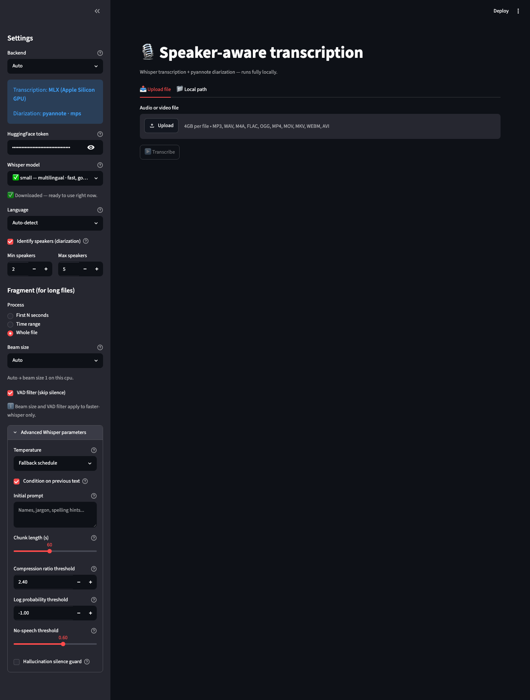
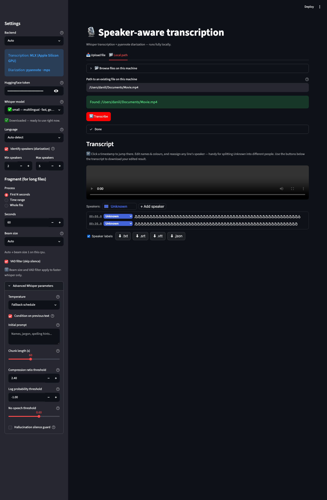
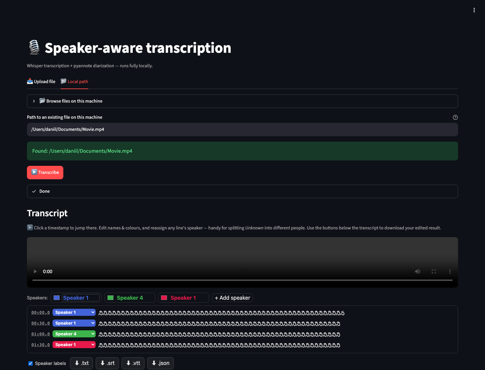

# Speaker Transcribe

Local transcription with speaker labels.

Speaker Transcribe uses Whisper for speech-to-text and pyannote.audio for
speaker diarization. It can process audio or video files and export transcripts
as text, JSON, SRT, or VTT.

## What It Does

- Transcribes audio and video files.
- Detects speakers and groups transcript lines by speaker.
- Lets you process the whole file, the first N seconds, or a time range.
- Runs from a Streamlit UI or the `transcribe` CLI.
- Exports `.txt`, `.json`, `.srt`, and `.vtt`.
- Runs locally. Audio is not sent to an external transcription API.

## Requirements

- Python 3.11 or 3.12
- [uv](https://docs.astral.sh/uv/)
- ffmpeg
- HuggingFace token for diarization

For diarization, create a HuggingFace token and accept the pyannote model terms:

- https://huggingface.co/settings/tokens
- https://huggingface.co/pyannote/speaker-diarization-community-1

Create `.env`:

```bash
cp .env.example .env
```

Then set:

```bash
HF_TOKEN=hf_...
```

If ffmpeg is missing:

```bash
brew install ffmpeg
```

Docker installs ffmpeg inside the image.

## Quick Start

```bash
make run
```

Open:

```text
http://localhost:8501
```

In the UI:

1. Choose a Whisper model.
2. Choose a language, or use auto-detect.
3. Choose whole file or a fragment.
4. Upload a file or enter a local path.
5. Click `Transcribe`.
6. Download the formats you need.

Use `small` for quick tests. Use `large-v3` or `large-v3-turbo` for better final output.

## CLI

Process the first 60 seconds:

```bash
uv run transcribe \
  --input sample-interview.mp3 \
  --duration 60 \
  --model small \
  --language auto \
  --formats txt srt
```

Process a specific range:

```bash
uv run transcribe \
  --input sample-meeting.mp4 \
  --start 120 \
  --duration 90 \
  --language auto \
  --formats txt json srt vtt
```

Write output files to a custom directory:

```bash
uv run transcribe \
  --input sample-meeting.mp4 \
  --out-dir outputs \
  --formats txt json
```

List available Whisper models:

```bash
uv run transcribe --list-models
```

## Docker

```bash
make docker-up
```

Open:

```text
http://localhost:8501
```

Docker notes:

- `HF_TOKEN` is read from your shell or `.env`.
- Model downloads are cached in `./hf_cache`.
- Put files in `./data` when using local paths inside Docker.
- In Docker, refer to those files as `/data/file.mp3`.

## Models And Backends

Backend selection:

- `auto`: MLX on Apple Silicon, otherwise faster-whisper.
- `mlx`: Apple Silicon GPU backend.
- `faster-whisper`: CUDA if available, otherwise CPU.

Useful models:

| Model | Best for |
| --- | --- |
| `small` | Fast tests |
| `medium` | Better quality without huge runtime |
| `large-v3` | Best quality, slow on CPU |
| `large-v3-turbo` / `turbo` | Near-large quality, faster |
| `distil-*` / `*.en` | English-only, faster |

## Output Files

The CLI writes files next to the input unless `--out-dir` is set.

Supported formats:

- `txt`: readable transcript
- `json`: structured segments
- `srt`: subtitles
- `vtt`: web subtitles

## Development

```bash
make test
make lint
make check
```

Direct commands:

```bash
uv run pytest
uv run ruff check .
uv run ruff format .
```

## Project Layout

```text
app.py                       Streamlit UI
src/speaker_transcribe/
  audio.py                   audio extraction and fragment handling
  cli.py                     transcribe command
  config.py                  settings, models, device detection
  export.py                  txt/json/srt/vtt exporters
  pipeline.py                Whisper + pyannote pipeline
tests/                       unit tests
```

## Screenshots

<p>
  
</p>

<p>
  
</p>

<p>
  
</p>

## Troubleshooting

`HF_TOKEN` errors:

- Check `.env`.
- Accept the pyannote model terms on HuggingFace.

Slow transcription:

- Use `small` or `medium` while testing.
- Use a fragment with `--duration`.
- Avoid `large-v3` on CPU for quick runs.

No speaker labels:

- Make sure diarization is enabled.
- Check that `HF_TOKEN` is valid.
- Set realistic `--min-speakers` and `--max-speakers`.

Docker local paths do not work:

- Put files in `./data`.
- Use `/data/<filename>` in the app.
