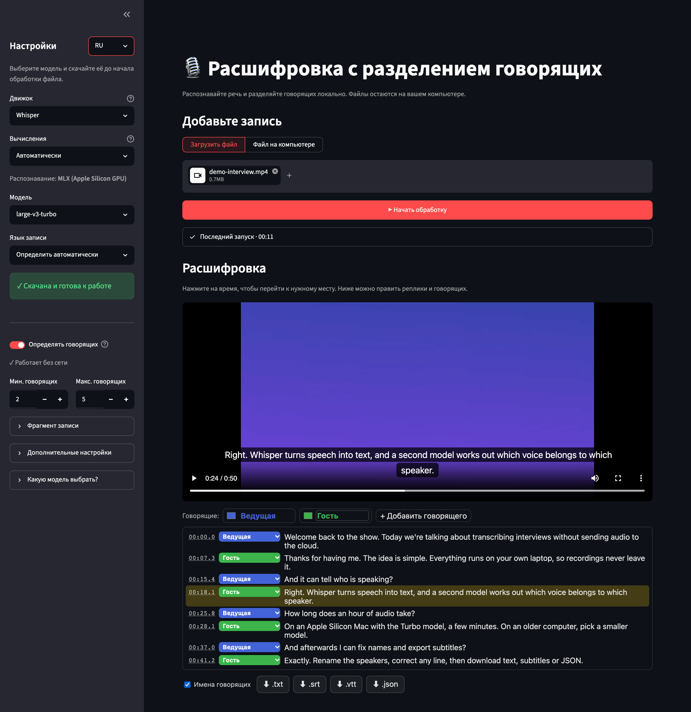

# 🎙️ Speaker Transcribe

[English](README.md) · **Русский**

[](LICENSE)   

Превращает интервью, встречи и подкасты в текст с пометками, **кто что сказал**, прямо
на вашем компьютере. Записи никуда не отправляются: ни облачных API, ни регистрации.

Текст распознаёт Whisper (или другой локальный движок распознавания речи), а
[pyannote](https://github.com/pyannote/pyannote-audio) определяет, кто говорит.
Результат можно проверить рядом с видео, поправить имена и реплики и скачать в TXT,
SRT, VTT или JSON.



## Возможности

- **Всё локально.** Аудио и видео остаются на компьютере, телеметрия отключена.
- **Говорящие.** Каждая реплика привязана к говорящему. В редакторе можно
  переименовать говорящих, сменить их цвет или переназначить реплику.
- **Интерактивная расшифровка.** Клик по времени перематывает запись, на видео
  показываются субтитры, любую строку можно исправить прямо в тексте.
- **Субтитры и данные.** Экспорт в `.txt`, `.srt`, `.vtt` и `.json`, с именами
  говорящих или без них.
- **Пять движков.** Whisper (99 языков), NVIDIA Parakeet, Qwen3-ASR, SenseVoice и
  GigaAM v3 / v2 для русского языка.
- **Использует ваше железо.** Графика Apple Silicon через MLX, видеокарты NVIDIA через
  CUDA или процессор.
- **Длинные записи.** Можно обработать весь файл, первые N секунд или интервал.
  Если обработка зависла, она сама повторится по частям.
- **Интерфейс на русском и английском**, а для скриптов есть команда `transcribe`.

## Быстрый старт: одна команда

Одна команда скачивает проект, устанавливает всё нужное и открывает приложение в
браузере по адресу <http://127.0.0.1:8501>. Заранее ничего ставить не нужно, даже git
или Python: скрипт сам скачает [uv](https://docs.astral.sh/uv/) и Python 3.12 в папку
проекта. Права администратора не нужны, остальная система не затрагивается. Первый
запуск занимает несколько минут.

Выберите свою систему:

<details open>
<summary><b>🍎 macOS</b></summary>

Откройте **Терминал** (<kbd>⌘ Пробел</kbd> → наберите «Терминал» → <kbd>Enter</kbd>) и вставьте:

```bash
curl -fsSL https://github.com/GDaniil17/Speaker-aware-transcription-with-UI/archive/refs/heads/main.tar.gz | tar xz && cd Speaker-aware-transcription-with-UI-main && ./run.sh
```

Это быстрый старт: только Whisper, аккаунт не нужен. Mac с чипом M-серии и macOS 14+
используют графику, Mac на Intel — процессор. Чтобы включить **определение говорящих и
все движки**, замените в конце команды `./run.sh` на `./run.sh --full`
(см. [ниже](#как-включить-определение-говорящих)).

**В следующий раз** откройте Терминал и выполните:

```bash
cd Speaker-aware-transcription-with-UI-main && ./run.sh
```

</details>

<details>
<summary><b>🐧 Linux</b></summary>

Откройте терминал и вставьте:

```bash
curl -fsSL https://github.com/GDaniil17/Speaker-aware-transcription-with-UI/archive/refs/heads/main.tar.gz | tar xz && cd Speaker-aware-transcription-with-UI-main && ./run.sh
```

Это быстрый старт: Whisper на процессоре, аккаунт не нужен. Чтобы включить
**определение говорящих, все движки и видеокарты NVIDIA**, замените в конце команды
`./run.sh` на `./run.sh --full` (см. [ниже](#как-включить-определение-говорящих)).

Если `curl` не установлен, поставьте его: `sudo apt install curl` в Debian/Ubuntu или
`sudo dnf install curl` в Fedora. На сервере без рабочего стола откройте адрес с
другого компьютера через SSH-туннель: `ssh -L 8501:127.0.0.1:8501 ваш-сервер`.

**В следующий раз:**

```bash
cd Speaker-aware-transcription-with-UI-main && ./run.sh
```

</details>

<details>
<summary><b>🪟 Windows</b></summary>

Откройте **PowerShell** (<kbd>Win</kbd> → наберите «PowerShell» → <kbd>Enter</kbd>) и вставьте:

```text
iwr https://github.com/GDaniil17/Speaker-aware-transcription-with-UI/archive/refs/heads/main.zip -OutFile speaker-transcribe.zip -UseBasicParsing; Expand-Archive speaker-transcribe.zip . -Force; cd Speaker-aware-transcription-with-UI-main; .\run.bat
```

Это быстрый старт: Whisper на процессоре, аккаунт не нужен. Чтобы включить
**определение говорящих и все движки**, замените в конце команды `.\run.bat` на
`.\run.bat --full` (см. [ниже](#как-включить-определение-говорящих)).

**В следующий раз** откройте папку `Speaker-aware-transcription-with-UI-main` и дважды
щёлкните **`run.bat`** или выполните `.\run.bat` в PowerShell из этой папки. Если
SmartScreen предупредит о файле, выберите **Подробнее → Выполнить в любом случае**.

</details>

<details>
<summary><b>Удобнее через git?</b></summary>

```bash
git clone https://github.com/GDaniil17/Speaker-aware-transcription-with-UI.git
cd Speaker-aware-transcription-with-UI
./run.sh          # Windows: .\run.bat
```

Обновление — `git pull`; при следующем запуске доустановится всё, что изменилось.

</details>

Остановить приложение — <kbd>Ctrl</kbd>+<kbd>C</kbd> в окне терминала. При первом
запуске там будет примерно так:

```text
Preparing Python 3.12 and the Whisper environment…
Installing Apple Silicon GPU support (MLX)…
Starting Whisper large-v3-turbo (mlx). No Hugging Face token needed.
Open http://127.0.0.1:8501 if the browser does not open. Stop with Ctrl+C.
The model downloads on your first transcription; keep this terminal open.
```

### Два режима запуска

| | `./run.sh` / `run.bat` (быстрый старт) | `./run.sh --full` / `run.bat --full` |
| --- | --- | --- |
| Распознавание | Whisper | Whisper, Parakeet, Qwen3-ASR, SenseVoice, GigaAM |
| Определение говорящих | — (говорящих можно назначить вручную) | ✓ pyannote |
| Аккаунт Hugging Face | не нужен | бесплатный токен, один раз |
| Место на диске | меньше 1 ГБ + модель (~1,6 ГБ для `large-v3-turbo`) | несколько ГБ (PyTorch) + модели |
| Окружение | `.venv-whisper/` | `.venv/` (плюс команда `transcribe`) |

Быстрый старт сам выбирает самый быстрый вариант: **графику Apple Silicon (MLX)** на
Mac с чипом M-серии и macOS 14+, а в остальных случаях процессор через faster-whisper.
Чтобы на Mac принудительно работать на процессоре, добавьте `--cpu`. Полный режим
использует видеокарту NVIDIA, если её видит PyTorch.

### Как включить определение говорящих

Модель разделения говорящих
([pyannote/speaker-diarization-community-1](https://huggingface.co/pyannote/speaker-diarization-community-1))
бесплатная, но перед первым скачиванием Hugging Face просит принять её условия:

1. Создайте бесплатный аккаунт и токен с правами **read** на
   <https://huggingface.co/settings/tokens>.
2. Откройте [страницу модели](https://huggingface.co/pyannote/speaker-diarization-community-1)
   и примите условия.
3. Запустите `./run.sh --full` (или `run.bat --full`) и вставьте токен в
   **Настройки → Токен Hugging Face**. Чтобы не вставлять его каждый раз, можно
   прописать токен в файле `.env`: `HF_TOKEN=hf_...`.

Токен нужен один раз. После первого запуска модель хранится в `~/.cache/huggingface`
и работает без интернета, а сам токен в браузер не передаётся.

## Как пользоваться


1. **Выберите движок и модель** в боковой панели. Whisper `large-v3-turbo` хорошо
   подходит по умолчанию. В первый раз нажмите **Скачать модель**: на кнопке видно,
   сколько придётся скачать (например, 1,6 ГБ для `large-v3-turbo`), а прогресс
   сохраняется, даже если обновить страницу.
2. **Укажите язык записи** или оставьте **Определить автоматически**.
3. **Определять говорящих** (полный режим): при желании задайте минимальное и
   максимальное число людей.
4. **Добавьте запись**: загрузите файл (до 4 ГБ) или укажите путь к файлу на
   компьютере. Подходят и аудио, и видео: MP3, WAV, M4A, FLAC, OGG, AAC, MP4, MOV,
   MKV, WEBM, AVI.
5. **По желанию:** в разделе **Фрагмент записи** можно распознать только первые
   N секунд или интервал. Так удобно быстро проверить длинный файл.
6. Нажмите **Начать обработку**. У каждого шага свой таймер.
7. **Проверьте и скачайте**: клик по времени перематывает запись, имена говорящих
   и реплики можно исправить, затем скачайте нужный формат.

Подсказка **«Какую модель выбрать?»** в боковой панели советует движки под ваше железо
и показывает языки каждого движка. Переключатель **EN/RU** рядом с «Настройками»
меняет только язык интерфейса, а не язык записи.

<br clear="right">

## Движки и модели

| Движок | Модель | Языки | Полный режим (`--full`) |
| --- | --- | --- | --- |
| **Whisper** | `tiny` … `large-v3`, `large-v3-turbo`, `distil-*` | 99 языков | уже включён |
| **Parakeet** (NVIDIA) | `parakeet-tdt-0.6b-v3` | 25 европейских, язык определяет сама | уже включён |
| **Qwen3-ASR** | `Qwen3-ASR-1.7B` + выравнивание по словам | 30 | уже включён |
| **SenseVoice** | `SenseVoiceSmall` | китайский, кантонский, английский, японский, корейский | уже включён |
| **GigaAM v3** (Сбер) | `gigaam-v3-e2e-rnnt`, `gigaam-v3-e2e-ctc`, `gigaam-v3-rnnt`, `gigaam-v3-ctc` | русский | уже включён |
| **GigaAM v2** (Сбер) | `gigaam-v2-rnnt`, `gigaam-v2-ctc` | русский | уже включён |

`./run.sh --full` / `run.bat --full` ставит все движки. Если проект установлен
обычным `uv sync`, то Qwen3-ASR и SenseVoice — дополнительные пакеты: их можно
поставить командой `uv sync --inexact --extra qwen3-asr --extra sensevoice` или кнопкой
**Установить движок**, которая появляется в боковой панели для недостающего движка.

| Ваш компьютер | Что выбрать |
| --- | --- |
| **Apple Silicon** | Whisper `large-v3-turbo` (MLX, графика), Parakeet (MLX), SenseVoice, GigaAM для русского |
| **Видеокарта NVIDIA** | Whisper `large-v3` / `large-v3-turbo`, Parakeet, Qwen3-ASR |
| **Только процессор** | Whisper `small` / `medium`, `distil-*` для английского, SenseVoice, GigaAM для русского |

Полезно знать:

- **Скорость:** на Mac с чипом M-серии Whisper `large-v3-turbo` обрабатывает час
  записи за несколько минут. На старом процессоре начните с `small`.
- **Parakeet** определяет язык сам, поэтому выбор языка для него отключён. Он сразу
  работает на процессоре через ONNX (~670 МБ, около 2 секунд на минуту записи на Mac
  с чипом M-серии). Можно поставить более быстрые варианты: `uv sync --inexact --extra
  parakeet-mlx` для графики Apple Silicon или `--extra parakeet` (NVIDIA NeMo, несколько
  ГБ) для CUDA. Какой вариант используется, видно в боковой панели.
- **GigaAM**: выбрав движок, укажите **Версию GigaAM** (v3 или v2), затем модель.
  Модель по умолчанию, `gigaam-v3-e2e-rnnt`, расставляет знаки препинания и заглавные
  буквы и пишет числа цифрами («15 марта в 10:00»). Остальные модели v3 и обе модели
  v2 пишут строчными буквами без пунктуации. Варианты `*-ctc` чуть быстрее `*-rnnt`.
  Все они работают на процессоре через ONNX и очень быстры; каждая модель весит
  ~225 МБ.
- **Лицензии:** у каждой модели своя лицензия; перед коммерческим использованием
  проверьте страницу модели.

## Командная строка

Доступна после `./run.sh --full` (или `uv sync`):

```bash
uv run transcribe --input interview.mp3                     # весь файл → interview.txt + .srt
uv run transcribe --input meeting.mp4 --start 120 --duration 90 --formats txt json srt vtt
uv run transcribe --input lecture.m4a --language en --no-diarize --out-dir transcripts
uv run transcribe --engine gigaam --input call.wav           # GigaAM v3 e2e (по умолчанию)
uv run transcribe --engine gigaam --model gigaam-v2-rnnt --input call.wav
uv run transcribe --list-models                             # движки, модели, как установить
```

`--help` показывает все параметры, включая настройки декодера и восстановление после
зависаний.

## Docker

```bash
docker compose up --build        # или: make docker-up
```

Затем откройте <http://localhost:8501>. Положите записи в папку `./data` и указывайте
их в приложении как `/data/<файл>`. Модели сохраняются в `./hf_cache`, а `HF_TOKEN`
берётся из окружения или `.env`. Образ работает на процессоре.

## Длинные записи и восстановление после зависаний

Иногда длинный файл «застревает»: движок зацикливается на однообразном фрагменте или
одна большая операция не завершается. Если 10 минут нет прогресса, обработка
останавливается, и запись повторно распознаётся кусками по 5, затем по 2, затем по
1 минуте. Это настраивается в **Дополнительные настройки → Если обработка застряла**,
а в командной строке через `--stall-timeout`, `--chunk-ladder "5, 2, 1"`,
`--chunk-first` и `--fail-on-stall`. Говорящие всегда определяются по всему файлу
целиком, поэтому их имена совпадают во всех кусках.

## Приватность

Всё работает локально. Приложение слушает только `127.0.0.1` (кроме Docker), а
временная копия загруженного файла удаляется после обработки. Сбор статистики
pyannote отключён (`PYANNOTE_METRICS_ENABLED=false`), статистика Streamlit тоже.
Сеть нужна только для скачивания инструментов запуска, Python-пакетов и моделей.

## Если что-то не работает

<details>
<summary><b>macOS: «permission denied» или «не удаётся открыть»</b></summary>

Запускайте `bash run.sh` вместо `./run.sh`: при скачивании ZIP-архива у файла
пропадает право на запуск.
</details>

<details>
<summary><b>Windows: «выполнение сценариев отключено в этой системе»</b></summary>

Запускайте `run.bat`, а не `run.ps1`. Bat-файл разрешает скрипт только на этот запуск
и не меняет настройки системы.
</details>

<details>
<summary><b>Определение говорящих: «token required» или «403»</b></summary>

Примите условия на [странице модели](https://huggingface.co/pyannote/speaker-diarization-community-1)
под тем же аккаунтом, которому принадлежит токен, и попробуйте ещё раз. Токен нужен
только для первого скачивания.
</details>

<details>
<summary><b>Не используется видеокарта</b></summary>

- **Mac:** MLX нужен Apple Silicon и macOS 14+. Запускайте Терминал без Rosetta. Если
  ошибка графики возникает во время распознавания, перезапустите с `./run.sh --cpu`.
- **NVIDIA:** используйте `--full`. faster-whisper также нужны библиотеки CUDA 12
  cuBLAS и cuDNN 9; см. [документацию faster-whisper](https://github.com/SYSTRAN/faster-whisper#gpu).
</details>

<details>
<summary><b>Медленно или не хватает памяти</b></summary>

Выберите модель поменьше (`small`, `base`), проверьте на коротком отрывке
(**Фрагмент записи → Первые N секунд**) или выключите определение говорящих.
</details>

<details>
<summary><b>Порт 8501 занят</b></summary>

Скрипты запуска сами выбирают следующий свободный порт (8502, 8503, …) и печатают
адрес.
</details>

## Участие в разработке

Будем рады вашему вкладу. Как настроить окружение, как устроен код и как добавить
движок или перевод, описано в [CONTRIBUTING.md](CONTRIBUTING.md) (на английском).

## Благодарности

Проект основан на [Whisper](https://github.com/openai/whisper),
[faster-whisper](https://github.com/SYSTRAN/faster-whisper),
[mlx-whisper](https://github.com/ml-explore/mlx-examples/tree/main/whisper),
[pyannote.audio](https://github.com/pyannote/pyannote-audio),
[NVIDIA NeMo / Parakeet](https://huggingface.co/nvidia/parakeet-tdt-0.6b-v3),
[Qwen3-ASR](https://huggingface.co/Qwen/Qwen3-ASR-1.7B),
[SenseVoice](https://github.com/FunAudioLLM/SenseVoice),
[GigaAM](https://github.com/salute-developers/GigaAM) через
[onnx-asr](https://github.com/istupakov/onnx-asr),
[Streamlit](https://streamlit.io) и [uv](https://github.com/astral-sh/uv).

## Лицензия

[MIT](LICENSE). Модели скачиваются отдельно, и на них действуют их собственные
лицензии.
